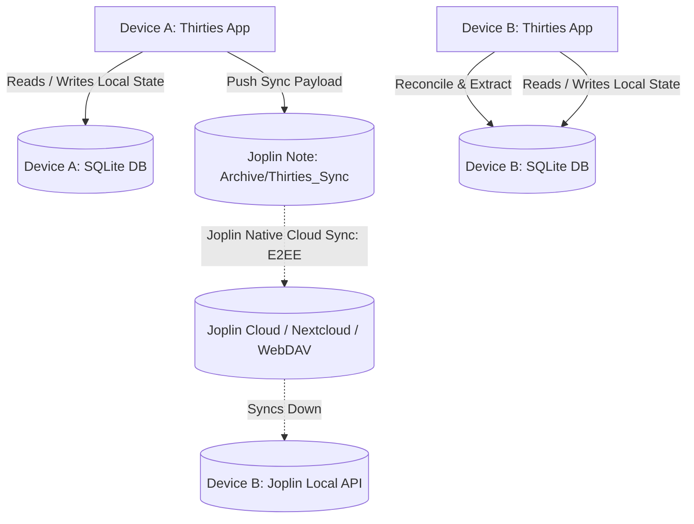
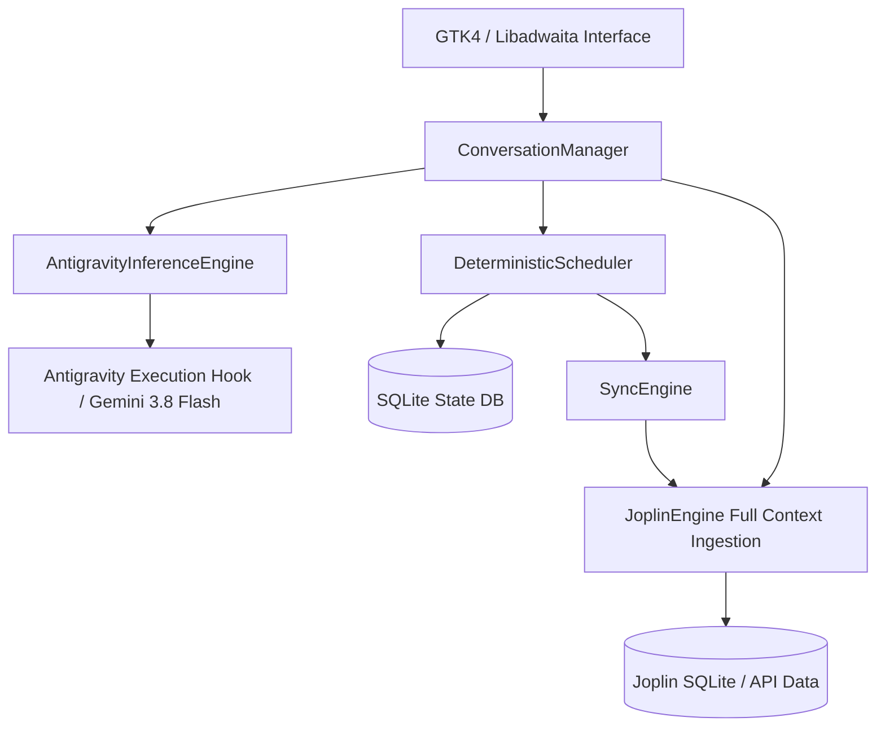

# Thirties Architectural Blueprint: The Practical Branch (`feat/practical-gemini-assistant`)

> **Branch Identity**: Production-ready, frontier-model scheduling assistant.
> **Primary Philosophy**: "Pragmatic Raw Power." Solve real user scheduling needs today using an intelligent frontier model (Gemini 3.8 Flash via Antigravity) rather than fighting the mathematical, taxonomic, and reasoning limitations of a 4B parameter on-device model.
> **Documentation Authority**: This file is the **sole primary source of truth** for this branch. Previous specs and phase plans in `docs/archive/` are historical references only.

---

## 1. Executive Context & The Dual-Track Strategy

The Thirties project is bifurcated into two parallel tracks:

| Dimension | Track 1: Practical Assistant (`feat/practical-gemini-assistant`) | Track 2: Research SLM (`feat/longterm-slm-architecture`) |
| :--- | :--- | :--- |
| **Objective** | Rock-solid daily personal scheduler that understands natural human speech, complex Joplin hierarchies, and cross-device sync *now*. | Research testbed for local 4B SLMs on mobile/desktop via radical primitive simplification and massive agentic evals. |
| **Model Backend** | **Gemini 3.8 Flash** (via Antigravity daemon/CLI/API). | **Gemma 4B** (via LiteRT-LM Vulkan/GPU). |
| **Cognitive Load** | Delegated to model's massive 1M+ context window and multi-hop reasoning. | Split strictly between deterministic Python code (math/sorting) and minimal model intent extraction. |
| **Sync Strategy** | **Joplin-as-Sync-Transport**: Serialized SQLite state & analytics buried in an Archive note. | Isolated local SQLite with prospective cloud sync. |
| **Success Metric** | User can plan their actual day every morning without friction, hallucinations, or defensiveness. | Pass rate on 500+ diverse, messy, human synthetic evaluation battery. |

If you are a newly initialized agent in a fresh session working on **this branch**, your mission is to deliver a **working, delightful, fully functional scheduling experience for the user immediately**. Do not waste time trying to shrink prompts, add regex workarounds, or squeeze 4B models on this branch.

---

## 2. Core Architectural Principles of the Practical Branch

### 2.1. Uncompromised Conversational Comprehension
Frontier models like Gemini 3.8 Flash excel at:
- **Elliptical human speech**: *"oh shoot, actually it went til 4:30"* naturally extends work from 7:00 AM to 4:30 PM without touching sleep or splitting blocks arbitrarily.
- **Relative nudges**: *"push it back an hour"*, *"give me 30 mins buffer"*, *"make lunch 15 mins earlier"*.
- **Diagnostic accountability**: When asked *"Why did you do that?"*, Gemini inspects the conversation history, recognizes what happened, and provides clear, humble, honest explanations rather than robotic defensive deflection.

### 2.2. Joplin Knowledge Integration
In this branch, the assistant is an active life-organizer, not just a grid clicker:
- **Full Taxonomy Ingestion**: Joplin task hierarchies (`3. Creative`, `1. Work`, `4. Chores`, `Admin/Taxes`) and task notes are fed into context.
- **Holistic Prioritization**: Gemini balances upcoming tax deadlines against long-term creative projects and daily chore deferrals naturally using common sense.
- **Velocity & History**: Ingests past task completion frequency and deferral counts to provide tough-love recommendations when tasks are chronically deferred.

### 2.3. Astronomical & Diurnal Alignment
The astronomical foundations of Thirties remain strictly honored:
- The day canvas begins at sunrise (Block 1).
- Discretionary time is strictly divided into Daylight Thirties (deep work, creative composing, high-focus problem solving) and Dark Thirties (reading, light admin, chores, calm wind-down).
- Gemini is instructed to map creative tasks into Daylight blocks and administrative/wind-down tasks into Dark blocks.

---

## 3. Cross-Device Synchronization Architecture (Joplin as Sync Transport)

### 3.1. The Multi-Device Reality
The user runs Thirties across multiple devices (e.g. desktop workstation and laptop):
- **Model Access**: Already solved (both devices have Antigravity installed with frontier model access).
- **Master Task Backlog**: Already solved (Joplin native sync handles user notes via Joplin Cloud / Dropbox / Nextcloud / WebDAV).
- **The Gap**: We need cross-device persistence for:
  1. **Daily Schedules**: Active DayPlan block allocations and assignments (local SQLite database `thirties.db`).
  2. **User Habits & Analytics**: Running completion rates, deferral counts, task velocities, diurnal preference statistics.
  3. **Conversational Continuity**: Recent Gemini conversation transcripts and assistant memory summaries.

### 3.2. The "Rugged & Pragmatic" Joplin Sync Solution
Rather than provisioning an external cloud server, API keys, or custom database infrastructure, Thirties leverages **Joplin's already configured, end-to-end encrypted synchronization backend**:



### 3.3. Sync Note Topology & Schema
Under the user's existing `Archive` notebook in Joplin:
- Create / identify sub-notebook: `Archive/Thirties_System/`
- Primary synchronization note: `Thirties_State_Sync` (tagged with `#thirties-system-sync`, marked read-only in user notes).

**Payload Format (JSON embedded in Markdown code block)**:
```json
{
  "$schema": "thirties.sync.v1",
  "device_id": "linux-workstation-uuid",
  "timestamp": "2026-10-10T12:45:00Z",
  "version": 1,
  "schedules": {
    "2026-10-10": {
      "blocks": [...],
      "updated_at": "2026-10-10T12:30:00Z"
    }
  },
  "analytics": {
    "task_velocities": {"task-123": {"completed_count": 5, "deferred_count": 2}},
    "habit_streaks": {"morning_planning": 12, "daylight_focus": 8},
    "preferences": {"target_sleep_hours": 8.0, "lunch_block": 11}
  },
  "conversations": {
    "recent_summaries": [
      {"date": "2026-10-10", "summary": "User extended work to 4:30 PM; focused afternoon on Dorico bridge composing."}
    ]
  }
}
```

### 3.4. Reconciliation Engine (`thirties_core/sync_engine.py`)
- **Push Trigger**: On schedule change, conversation close, or application pause/exit, Thirties serializes updated local SQLite tables and posts an updated sync note via Joplin Data API.
- **Pull Trigger**: On application startup or manual "Sync" trigger, Thirties reads `Thirties_State_Sync` from Joplin:
  - If `remote.timestamp > local.last_sync_timestamp`:
    - Merges schedule state using entity-level Last-Write-Wins (LWW) based on block update timestamps.
    - Merges analytics counters by taking the maximum/union of completed metrics.
    - Updates local SQLite `thirties.db`.

---

## 4. Cross-Branch Sharing & Backporting Protocol

Because `feat/practical-gemini-assistant` and `feat/longterm-slm-architecture` share the same GTK4 / Libadwaita UI shell, calendar connectors, and astronomical engine, improvements must be easily shared without contaminating branch-specific AI logic:

### 4.1. Strict Architectural Decoupling
To keep backporting seamless:
- **UI & Widget Code** (`thirties_gtk/`): Pure presentation. Interacts only via clean interfaces (`ConversationManager`, `DeterministicScheduler`). Contains **no model-specific hacks**.
- **Astronomy & Domain Models** (`thirties_core/astronomy.py`, `thirties_core/models.py`): Common math and data representations.
- **Inference Engines** (`thirties_core/inference.py`): Strictly modular. `AntigravityInferenceEngine` lives alongside `LiteRTInferenceEngine` behind the `InferenceEngine` protocol.

### 4.2. Cherry-Picking & Sharing Workflow
When a bug fix, UI enhancement, or utility is created on either branch:
1. **Commit with Atomic Scopes**:
   - `fix(ui): adjust solar arc stroke rendering for dark mode`
   - `feat(calendar): support recurring GNOME EDS events`
   - `fix(gtk): resolve viewport scrolling clamp in conversation list`
2. **Cherry-Pick to Sister Branch**:
   ```bash
   git checkout feat/longterm-slm-architecture
   git cherry-pick <commit-hash>
   ```
3. **Dedicated Common Branches for Large Features**:
   If a major non-AI feature is developed (e.g. Google Calendar integration, a brand new visual timeline widget), branch from `main` (or PoC head), complete the feature, merge/cherry-pick into both branches.

---

## 5. Implementation Design & Component Architecture



### 5.1. `AntigravityInferenceEngine` (`thirties_core/inference.py`)
Conforms to the standard `InferenceEngine` protocol:
```python
class AntigravityInferenceEngine:
    """Dispatches conversation turns to Gemini 3.8 Flash via Antigravity."""
    def chat(self, messages: List[Dict[str, Any]], tools: Optional[List[Dict[str, Any]]] = None) -> Dict[str, Any]:
        # Formats system prompt, user dialogue, and tools
        # Invokes Antigravity host hook / CLI / Python SDK
        # Returns structured assistant response and extracted tool calls
```

### 5.2. Configuration & Backend Toggling
In `thirties_core/config.py`:
```toml
[inference]
backend = "gemini" # Options: "gemini", "litert", "mock"
gemini_model = "gemini-3.8-flash"

[sync]
enabled = true
notebook_name = "Archive"
sync_subfolder = "Thirties_System"
```
The application dynamically selects `AntigravityInferenceEngine` when `backend = "gemini"`, falling back to `LiteRTInferenceEngine` or `MockInferenceEngine` when offline.

---

## 6. Immediate Development Roadmap for this Branch

1. **Implement `AntigravityInferenceEngine`**: Establish the CLI / SDK invocation bridge to Gemini 3.8 Flash.
2. **Wire Config & UI**: Add backend selector to `config.toml` and verify GTK app loads Gemini engine cleanly.
3. **Build Joplin Sync Engine (`thirties_core/sync_engine.py`)**: Implement serialization of local SQLite schedules and stats into `Archive/Thirties_System/Thirties_State_Sync`.
4. **Enrich Joplin Ingestion**: Expand `JoplinEngine` to pass full notebook hierarchies, deferral counts, and deadlines into `ConversationManager`.
5. **End-to-End User Validation**: Test messy, multi-turn dialogues directly in the running GTK app (`oh shoot it went til 4:30`, diagnostic inquiries, cross-device sync).
