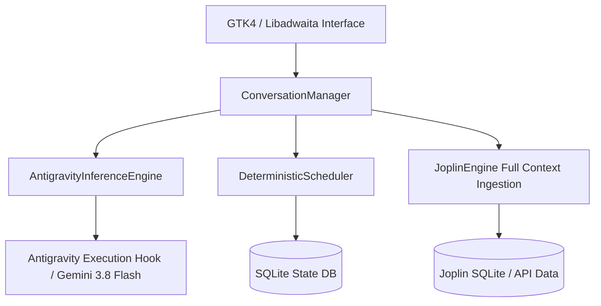

# Thirties Architectural Blueprint: The Practical Branch (`feat/practical-gemini-assistant`)

> **Branch Identity**: Production-ready, frontier-model scheduling assistant.
> **Primary Philosophy**: "Pragmatic Raw Power." Solve real user scheduling needs today using an intelligent frontier model (Gemini 3.8 Flash via Antigravity) rather than fighting the mathematical, taxonomic, and reasoning limitations of a 4B parameter on-device model.

---

## 1. Executive Context & The Branch Split

The Thirties project is bifurcated into two parallel tracks:

| Dimension | Track 1: Practical Assistant (`feat/practical-gemini-assistant`) | Track 2: Research SLM (`feat/longterm-slm-architecture`) |
| :--- | :--- | :--- |
| **Objective** | Rock-solid daily personal scheduler that understands natural human speech and complex Joplin hierarchies *now*. | Research testbed for local 4B SLMs on mobile/desktop via radical primitive simplification and massive agentic evals. |
| **Model Backend** | **Gemini 3.8 Flash** (via Antigravity daemon/CLI/API). | **Gemma 4B** (via LiteRT-LM Vulkan/GPU). |
| **Cognitive Load** | Delegated to model's massive 1M+ context window and multi-hop reasoning. | Split strictly between deterministic Python code (math/sorting) and minimal model intent extraction. |
| **Success Metric** | User can plan their actual day every morning without friction, hallucinations, or defensiveness. | Pass rate on 500+ diverse, messy, human synthetic evaluation battery. |

If you are a newly initialized agent in a fresh session working on **this branch**, your mission is to deliver a **working, delightful scheduling experience for the user immediately**. Do not waste time trying to shrink prompts or squeeze 4B models on this branch.

---

## 2. Core Architectural Principles of the Practical Branch

### 2.1. Uncompromised Conversational Comprehension
Frontier models like Gemini 3.8 Flash excel at:
- **Elliptical human speech**: *"oh shoot, actually it went til 4:30"* naturally extends work from 7:00 AM to 4:30 PM without touching sleep or splitting blocks arbitrarily.
- **Relative nudges**: *"push it back an hour"*, *"give me 30 mins buffer"*, *"make lunch 15 mins earlier"*.
- **Diagnostic accountability**: When asked *"Why did you do that?"*, Gemini inspects the conversation history, recognizes what happened, and provides clear, humble, honest explanations rather than robotic defensive deflection.

### 2.2. Joplin Knowledge Integration
In this branch, the assistant is an active life-organizer, not just a grid clicker:
- **Full Taxonomy Ingestion**: Joplin task hierarchies (`3. Creative`, `1. Work`, `4. Chores`, `Admin/Taxes`) and task notes are fed into context.
- **Holistic Prioritization**: Gemini balances upcoming tax deadlines against long-term creative projects and daily chore deferrals naturally using common sense.
- **Velocity & History**: Ingests past task completion frequency and deferral counts to provide tough-love recommendations when tasks are chronically deferred.

### 2.3. Astronomical & Diurnal Alignment
The astronomical foundations of Thirties remain strictly honored:
- The day canvas begins at sunrise (Block 1).
- Discretionary time is strictly divided into Daylight Thirties (deep work, creative composing, high-focus problem solving) and Dark Thirties (reading, light admin, chores, calm wind-down).
- Gemini is instructed to map creative tasks into Daylight blocks and administrative/wind-down tasks into Dark blocks.

---

## 3. Implementation Design & Component Architecture



### 3.1. `AntigravityInferenceEngine` (`thirties_core/inference.py`)
Conforms to the standard `InferenceEngine` protocol:
```python
class AntigravityInferenceEngine:
    """Dispatches conversation turns to Gemini 3.8 Flash via Antigravity."""
    def chat(self, messages: List[Dict[str, Any]], tools: Optional[List[Dict[str, Any]]] = None) -> Dict[str, Any]:
        # Formats system prompt, user dialogue, and tools
        # Invokes Antigravity host hook / CLI / Python SDK
        # Returns structured assistant response and extracted tool calls
```

### 3.2. Configuration & Backend Toggling
In `thirties_core/config.py`:
```toml
[inference]
backend = "gemini" # Options: "gemini", "litert", "mock"
gemini_model = "gemini-3.8-flash"
```
The application dynamically selects `AntigravityInferenceEngine` when `backend = "gemini"`, falling back to `LiteRTInferenceEngine` or `MockInferenceEngine` when offline.

### 3.3. Expanded Joplin Payload
Instead of sending a truncated top-10 list of task titles, `ConversationManager` serializes:
- Active notebooks and hierarchy.
- Due dates and impending deadlines.
- Deferral counts and days since first scheduled.
- Rich task descriptions and checklist sub-items.

---

## 4. Immediate Development Roadmap for this Branch

1. **Implement `AntigravityInferenceEngine`**: Establish the CLI / SDK invocation bridge to Gemini 3.8 Flash.
2. **Wire Config & UI**: Add backend selector to `config.toml` and verify GTK app loads Gemini engine cleanly.
3. **Enrich Joplin Ingestion**: Expand `JoplinEngine` to pass full notebook hierarchies and deadlines into `ConversationManager`.
4. **End-to-End User Validation**: Test messy, multi-turn dialogues directly in the running GTK app (`oh shoot it went til 4:30`, diagnostic inquiries, task trade-offs).
