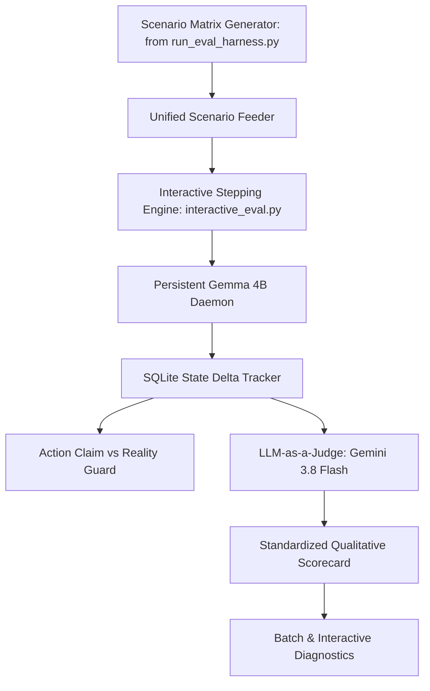

# Thirties Architectural Blueprint: The Philosophical SLM Branch (`feat/longterm-slm-architecture`)

> **Branch Identity**: Long-term research testbed for autonomous, on-device small language models (4B parameters, LiteRT-LM).
> **Primary Philosophy**: "Primacy of Primitives & Agentic Evaluation." Small models fail when forced to perform mental arithmetic, container ontology gymnastics, or multi-factor constraint optimization. Success requires radically simplifying the data model so the model only does what it excels at (dialogue & intent extraction), letting deterministic Python do the heavy lifting, and steering development with an exhaustive, agent-as-human evaluation battery.
> **Documentation Authority**: This file is the **sole primary source of truth** for this branch. Previous specs and phase plans in `docs/archive/` are historical references only.

---

## 1. Executive Context & The Branch Split

If you are a newly initialized agent in a fresh session working on **this branch**, your mission is **not** to hack together prompt workarounds or ad-hoc overrides. Your mission is to **solve the fundamental architectural friction points** between small local models (Gemma 4B / LiteRT) and temporal scheduling.

| Dimension | Track 1: Practical Assistant (`feat/practical-gemini-assistant`) | Track 2: Research SLM (`feat/longterm-slm-architecture`) |
| :--- | :--- | :--- |
| **Objective** | Rock-solid daily personal scheduler that understands natural human speech and complex Joplin hierarchies *now*. | Research testbed for local 4B SLMs on mobile/desktop via radical primitive simplification and massive agentic evals. |
| **Model Backend** | **Gemini 3.8 Flash** (via Antigravity daemon/CLI/API). | **Gemma 4B** (via LiteRT-LM Vulkan/GPU). |
| **Cognitive Load** | Delegated to model's massive 1M+ context window and multi-hop reasoning. | Split strictly between deterministic Python code (math/sorting) and minimal model intent extraction. |
| **Success Metric** | User can plan their actual day every morning without friction, hallucinations, or defensiveness. | Pass rate on 500+ diverse, messy, human synthetic evaluation battery. |

---

## 2. Core Architectural Principles of the Philosophical Branch

### 2.1. Option B: The Uniform Astronomical Event Canvas
**The Root Cause of SLM Failure**:
Currently, the system forces Gemma 4B to juggle two mutually interfering concepts:
1. *Block Types / Container Envelopes*: Is this block `kind=WORK`, `kind=SLEEP`, or `kind=DISCRETIONARY`? Does modifying work collapse sleep? Which block number (1–48) does 4:30 PM map to?
2. *Events / Tasks*: Is this a calendar appointment or an assigned task label?

When a user says *"oh shoot, actually it went til 4:30"*, the 4B model gets tangled in mental arithmetic, splits blocks arbitrarily (1–15 and 16–22), and hallucinates sleep starting at 4:30 PM (Block 23).

**The Architectural Solution (Option B)**:
- **The Universe controls the Canvas**: Every block (1–48) is solely either **Daylight** or **Dark** based on NOAA solar phase calculations. It never mutates based on user activity.
- **Humans control Events on the Canvas**: Everything on the schedule is a uniform **Event Span** in natural clock time:
  - `Work`: An event from 7:00 AM to 4:30 PM (rendered visually as a collapsible amber banner).
  - `Sleep`: An event from 11:00 PM to 7:00 AM (rendered visually as a collapsible indigo banner).
  - `Dorico Composing`: An event from 5:00 PM to 6:30 PM.
  - `Doctor Appointment`: An event from 4:00 PM to 4:30 PM.
- **Model Directives are purely clock-time event based**:
  ```text
  SCHEDULE_EVENT: <title> | <start_time> - <end_time>
  CLEAR_EVENT: <title_or_time>
  ```
- The model **never calculates block numbers (1–48)** and **never decides container kinds**. Deterministic Python maps clock times to discrete thirties, handles collapsible rendering, and enforces schedule integrity.

### 2.2. Deterministic Joplin Pre-Scoring (The Division of Labor)
A 4B model cannot evaluate 30 raw Joplin notes across 4 hierarchy layers, calculate deadline decay, analyze past deferral history, and balance creative daylight flow simultaneously. It suffers from context saturation and multi-hop reasoning failure.

**The Solution**:
- **Python does the math and ranking**:
  Before the model sees the prompt, a deterministic scoring algorithm ranks all backlog tasks:
  $$\text{Score} = \text{DeadlineWeight}(\text{due\_date}) + \text{CategoryWeight} + \text{DeferralPenalty} - \text{Friction}$$
- **Model receives a curated briefing of the top 3–5 candidate tasks**:
  ```text
  TOP CANDIDATES TODAY:
  1. [t_taxes] "File 1099 Forms" (URGENT: Due in 5 days)
  2. [t_dorico] "Compose bridge in Dorico" (CREATIVE: Peak daylight)
  3. [t_cables] "Clean studio cables" (CHORE: Evening dark hours, deferred 2x)
  ```
- The model’s only job is natural, empathetic conversational translation and negotiating trade-offs with the user.

---

## 3. The Evaluation Engine: Inventory, Reconciliation & Expansion

In this branch, **the Evaluation Harness IS the primary development engine**. We do not tweak prompts blindly. We rely on two foundational test harnesses already developed in the repository:

### 3.1. Inventory of Current Evaluation Harnesses

1. **The Autonomous Combinatorial Harness (`tests/run_eval_harness.py`)**:
   - **Origin**: The large-scale stress-testing engine developed to run up to 500+ or 1,000 synthetic simulations.
   - **Key Strengths**:
     - Exhaustive multidimensional scenario generator covering diverse personas (shift worker, anxious deadline rusher, creative flow composer, decision-fatigued minimalist).
     - Messy communication styles (terse, rambling, contradictory, sudden mind-changes, typos).
     - Combinatorial task loads and calendar conflict injection.
     - Persistent GPU daemon management with auto-restart and sub-process crash isolation.
     - Batch statistical reporting across dimensions.

2. **The Stepping & Qualitative Judge Harness (`tests/interactive_eval.py`)**:
   - **Origin**: The interactive stepping and qualitative evaluation engine with real state deltas.
   - **Key Strengths**:
     - Turn-by-turn stepping and human-in-the-loop interactive control.
     - Tracks real SQLite / DayPlan state deltas between turns (`PlanSnapshot`, `StateDelta`).
     - Action Claim vs Reality verification: checks if the model's textual claim matches actual database state mutations.
     - Frontier LLM-as-a-judge protocol with qualitative scorecards across 5 axes: Action Execution Accuracy, Diurnal Temporal Awareness, Conversational Tone & Empathy, Directive Adherence, and Diagnostic Accountability.
     - 25 curated qualitative battery scenarios.

### 3.2. Reconciliation Strategy: Unifying Both Harnesses
The two harnesses are complementary halves of the ideal testing engine:
- `tests/run_eval_harness.py` provides the **Scenario Generation Breadth** (massive matrix of personas, communication styles, and messy edge cases).
- `tests/interactive_eval.py` provides the **Evaluation Depth & Truth Verification** (real SQLite delta tracking, claim vs reality checking, and qualitative scorecards).

**Reconciliation Architecture**:


To reconcile them:
1. Extract the scenario generator classes from `tests/run_eval_harness.py` into a reusable module or import them directly into `interactive_eval.py`.
2. Allow `tests/interactive_eval.py` to accept scenarios either from the curated 25-scenario battery OR generated on-the-fly from the 500+ combinatorial space (`--generator-matrix`, `--seed`, `--count 100`).
3. Ensure both batch mode (autonomous headless execution) and interactive mode (step, pause, challenge) share the same underlying SQLite delta tracking and scoring logic.

### 3.3. Expansion Roadmap Post-Reconciliation
1. **Tier 1 (Smoke & Sanity)**: 10 core regression scenarios run in seconds with mock/fast engine before any commit.
2. **Tier 2 (Qualitative Battery)**: 25 curated scenarios run against local Gemma 4B to evaluate conversational nuances.
3. **Tier 3 (Combinatorial Stress Matrix)**: 100 to 500 multi-turn scenarios generated dynamically to evaluate edge-case robustness, memory retention, and schedule invariants.
4. **Architectural Diagnosis Reports**: Evaluation failures should categorize errors by root cause:
   - Arithmetic / Block calculation failure (signals need for Python abstraction).
   - Prompt context saturation (signals need for tighter pre-scoring).
   - Invariant violation (signals need for deterministic guardrail).

---

## 4. Cross-Branch Sharing & Backporting Protocol

Because `feat/longterm-slm-architecture` and `feat/practical-gemini-assistant` share the same GTK4 / Libadwaita UI shell, calendar connectors, and astronomical engine, improvements must be easily shared without contaminating branch-specific AI logic:

### 4.1. Strict Architectural Decoupling
- **UI & Presentation** (`thirties_gtk/`): Must remain model-agnostic. All UI components communicate through standard interfaces (`ConversationManager`, `DeterministicScheduler`).
- **Domain Models & Utilities** (`thirties_core/astronomy.py`, `thirties_core/calendar_engine.py`): Common math and data representations.
- **Inference Engines** (`thirties_core/inference.py`): Modular backends (`LiteRTInferenceEngine` vs `AntigravityInferenceEngine`).

### 4.2. Cherry-Picking & Sharing Workflow
When a bug fix, UI enhancement, or utility is created on either branch:
1. **Commit with Atomic Scopes**:
   - `fix(ui): adjust solar arc stroke rendering for dark mode`
   - `feat(calendar): support recurring GNOME EDS events`
   - `fix(gtk): resolve viewport scrolling clamp in conversation list`
2. **Cherry-Pick to Sister Branch**:
   ```bash
   git checkout feat/practical-gemini-assistant
   git cherry-pick <commit-hash>
   ```
3. **Dedicated Common Branches for Large Features**:
   If a major non-AI feature is developed (e.g. Google Calendar integration, a brand new visual timeline widget), branch from `main` (or PoC head), complete the feature, merge/cherry-pick into both branches.

---

## 5. Immediate Development Roadmap for this Branch

1. **Refactor Data Model to Option B**:
   - Flatten `BlockKind` so blocks only represent `DAYLIGHT` vs `DARK`.
   - Implement uniform `EventSpan` records for Work, Sleep, Tasks, and Appointments.
2. **Deprecate Block-Number Directives**:
   - Simplify directives to `SCHEDULE_EVENT` and `CLEAR_EVENT` in natural clock time.
3. **Build Deterministic Joplin Pre-Scorer**:
   - Implement ranking algorithm in `thirties_core/scheduler.py` based on due dates and deferral history.
4. **Reconcile Evaluation Harnesses**:
   - Wire `run_eval_harness.py` scenario generator into `interactive_eval.py`.
   - Run 100-scenario evaluation round to measure Option B gains on Gemma 4B.
