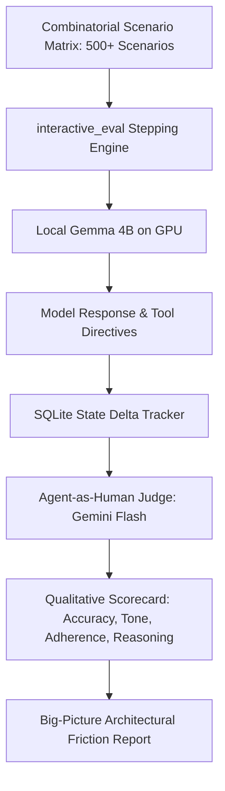

# Thirties Architectural Blueprint: The Philosophical SLM Branch (`feat/longterm-slm-architecture`)

> **Branch Identity**: Long-term research testbed for autonomous, on-device small language models (4B parameters, LiteRT-LM).
> **Primary Philosophy**: "Primacy of Primitives & Agentic Evaluation." Small models fail when forced to perform mental arithmetic, container ontology gymnastics, or multi-factor constraint optimization. Success requires radically simplifying the data model so the model only does what it excels at (dialogue & intent extraction), letting deterministic Python do the heavy lifting, and steering development with an exhaustive, agent-as-human evaluation battery.

---

## 1. Executive Context & The Branch Split

If you are a newly initialized agent in a fresh session working on **this branch**, your mission is **not** to hack together prompt workarounds or ad-hoc overrides. Your mission is to **solve the fundamental architectural friction points** between small local models (Gemma 4B / LiteRT) and temporal scheduling.

| Dimension | Track 1: Practical Assistant (`feat/practical-gemini-assistant`) | Track 2: Research SLM (`feat/longterm-slm-architecture`) |
| :--- | :--- | :--- |
| **Objective** | Rock-solid daily personal scheduler that understands natural human speech and complex Joplin hierarchies *now*. | Research testbed for local 4B SLMs on mobile/desktop via radical primitive simplification and massive agentic evals. |
| **Model Backend** | **Gemini 3.8 Flash** (via Antigravity daemon/CLI/API). | **Gemma 4B** (via LiteRT-LM Vulkan/GPU). |
| **Cognitive Load** | Delegated to model's massive 1M+ context window and multi-hop reasoning. | Split strictly between deterministic Python code (math/sorting) and minimal model intent extraction. |
| **Success Metric** | User can plan their actual day every morning without friction, hallucinations, or defensiveness. | Pass rate on 500+ diverse, messy, human synthetic evaluation battery. |

---

## 2. Core Architectural Principles of the Philosophical Branch

### 2.1. Option B: The Uniform Astronomical Event Canvas
**The Root Cause**: Currently, the system forces the model to juggle two distinct concepts:
1. *Block Types / Envelopes*: Is this a `kind=WORK`, `kind=SLEEP`, or `kind=DISCRETIONARY` container? Does modifying work collapse sleep?
2. *Events / Tasks*: Is this a calendar appointment or an assigned task label?

When a user says *"oh shoot, actually it went til 4:30"*, the model gets tangled in mental block math, splits blocks arbitrarily, and hallucinates sleep starting at 4:30 PM.

**The Solution (Option B)**:
- **The Universe controls the Canvas**: Every block (1–48) is solely either **Sunlight** or **Dark** based on NOAA solar phase calculations. No negotiation, no mutations.
- **Humans control Events on the Canvas**: Everything on the schedule is an **Event Span** in natural clock time:
  - `Work`: An event from 7:00 AM to 4:30 PM (rendered visually as a collapsible amber banner).
  - `Sleep`: An event from 11:00 PM to 7:00 AM (rendered visually as a collapsible indigo banner).
  - `Dorico Composing`: An event from 5:00 PM to 6:30 PM.
  - `Doctor Appointment`: An event from 4:00 PM to 4:30 PM.
- **Model Directives are purely event-based**:
  ```text
  SCHEDULE_EVENT: <title> | <start_time> - <end_time>
  CLEAR_EVENT: <title_or_time>
  ```
- The model **never calculates block numbers (1–48)** and **never decides container kinds**. Deterministic Python maps clock times to discrete thirties, handles collapsible rendering, and enforces schedule integrity.

### 2.2. Deterministic Joplin Pre-Scoring (The Division of Labor)
A 4B model cannot evaluate 30 raw Joplin notes across 4 hierarchy layers, calculate deadline decay, analyze past deferral history, and balance creative daylight flow simultaneously. It suffers from context saturation and multi-hop reasoning failure.

**The Solution**:
- **Python does the math and ranking**:
  Before the model sees the prompt, a deterministic scoring algorithm ranks all backlog tasks:
  $$\text{Score} = \text{DeadlineWeight}(\text{due\_date}) + \text{CategoryWeight} + \text{DeferralPenalty} - \text{Friction}$$
- **Model receives a curated briefing of the top 3–5 candidate tasks**:
  ```text
  TOP CANDIDATES TODAY:
  1. [t_taxes] "File 1099 Forms" (URGENT: Due in 5 days)
  2. [t_dorico] "Compose bridge in Dorico" (CREATIVE: Peak daylight)
  3. [t_cables] "Clean studio cables" (CHORE: Evening dark hours, deferred 2x)
  ```
- The model’s only job is natural, empathetic conversational translation and negotiating trade-offs with the user.

---

## 3. The Core Engine: Massive Agent-as-Human Evaluation Suite

In this branch, **the Evaluation Harness IS the primary development driver**. In an industry setting, an app like this requires thousands of human-tester hours. Here, we use frontier models (Gemini Flash in Antigravity) as **simulated human judges and interactive conversation partners**.



### 3.1. The 500+ Combinatorial Scenario Battery
The evaluation suite must incorporate the complete spectrum of messy human dialogue:
- **Elliptical human speech**: *"it went til 4:30"*, *"actually nevermind"*, *"make it 15 mins later"*.
- **Relative nudges**: *"push it back an hour"*, *"give me a 30 min buffer"*.
- **Adversarial & Impossible requests**: 4 hours into a 1-hour window, overlapping locked calendar appointments.
- **Diagnostic challenges**: *"Why did you do that?"*, *"Did that wipe out my morning work?"*.
- **Archetypes**: Shift worker, anxious deadline rusher, decision-fatigued minimalist, creative flow composer.

### 3.2. Diagnostic Architectural Reporting (Not Just Prompt Band-Aids)
When a test fails, the evaluation judge does not simply recommend adding another regex or prompt instruction. It asks:
1. *What tool was the model attempting to use?*
2. *Was the model forced to do math or conceptual gymnastics it is bad at?*
3. *How can deterministic Python take over that cognitive burden?*

---

## 4. Immediate Development Roadmap for this Branch

1. **Refactor Data Model to Option B**:
   - Flatten `BlockKind` so blocks only represent `DAYLIGHT` vs `DARK`.
   - Implement uniform `EventSpan` records for Work, Sleep, Tasks, and Appointments.
2. **Deprecate Block-Number Directives**:
   - Simplify directives to `SCHEDULE_EVENT` and `CLEAR_EVENT` in natural clock time.
3. **Build Deterministic Joplin Pre-Scorer**:
   - Implement ranking algorithm in `thirties_core/scheduler.py` based on due dates and deferral history.
4. **Scale Evaluation Battery to 100+ and 500+ Scenarios**:
   - Expand `tests/run_qualitative_battery.py` to stress-test messy conversational dynamics at scale.
